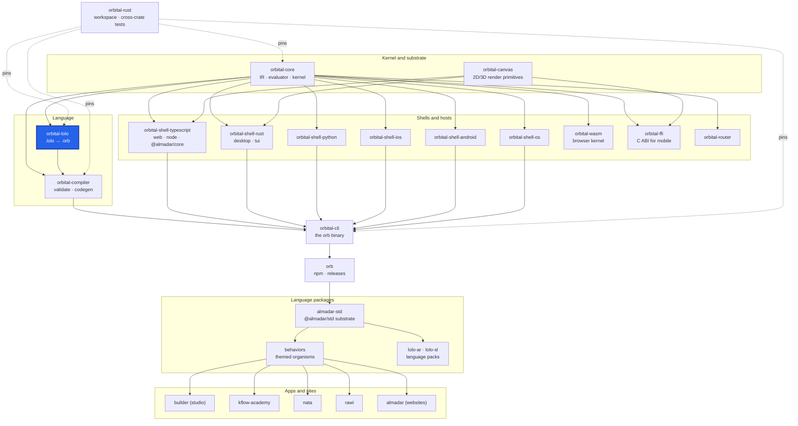

<div align="center">

# orbital-lolo

**The L1 front end: lexes, parses and lowers `.lolo` source to the `.orb` IR (`OrbitalSchema`), and unlowers it back.**

[](https://github.com/almadar-io/orbital-lolo/actions/workflows/ci.yml) [](LICENSE)

</div>

`.lolo` is the Lisp-flavoured surface notation people and LLMs write; `.orb` JSON is the IR the rest of the toolchain reads. This crate lexes and parses `.lolo` into an AST and lowers it to an `OrbitalSchema` from `orbital-core`, with author-time errors, source maps back to the text, a formatter and completion. The result feeds the compiler pipeline unchanged.

## Where this fits



| Upstream (this repo depends on) | Downstream (depends on this repo) |
|---|---|
| [orbital-core](https://github.com/almadar-io/orbital-core): IR types, evaluator and the language data readers (`orbital-core-base`, `orbital-core-eval`) | [orbital-cli](https://github.com/almadar-io/orbital-cli): the `orb` binary parses and lowers `.lolo` through this crate |
| | [orbital-integration-tests](https://github.com/almadar-io/orbital-integration-tests): cross-crate tests lower programs with it |

The `.orb` it produces is what [orbital-compiler](https://github.com/almadar-io/orbital-compiler) validates and generates from; the two are siblings with no dependency between them (the compiler is only a dev-dependency here, for tests).

## Quick start

```bash
npm install --no-save --no-package-lock @almadar/core @almadar/std @almadar/lolo-ar @almadar/lolo-sl
cargo test
```

To lower a program from the command line, use `orb` ([orbital-cli](https://github.com/almadar-io/orbital-cli)); this repo is a library.

## What's inside

Directories under `src/` are organizational only: each module is declared in `lib.rs` with a `#[path]` attribute, so public paths stay flat (`orbital_lolo::lexer`, not `orbital_lolo::syntax::lexer`).

| Path | Role |
|---|---|
| `src/syntax/` | `ast`, `error`, `keywords`, `lexer` |
| `src/parser/` | `.lolo` source to AST: entities, traits, pages, orbitals, expressions, JSX, types, grants |
| `src/lower/` | AST to `OrbitalSchema`, with the lowering-time checks (payload contracts, config knobs, orbital refs, tree folds) |
| `src/unlower/` | `.orb` back to `.lolo` |
| `src/check/` | Alias and type resolution against the installed language (`registry`, `types`, `patterns_meta`) |
| `src/spans/` | Side channels from IR back to source: `source_map`, `embeds`, `orb_json` |
| `src/tooling/` | `format`, `complete`, the generated language `reference` |
| `src/program/` | Program-level loading |
| `tests/` | One integration test file per lowering rule, plus `fixtures/` |

`build.rs` uses `syn` and `quote` at build time.

## Development

The crate reads the Almadar language data (patterns, operators, themes, vocabularies) from installed npm packages, so install those first (this is the CI recipe; the toolchain is pinned to Rust 1.93.0 in `rust-toolchain.toml`):

```bash
npm install --no-save --no-package-lock @almadar/core @almadar/std @almadar/lolo-ar @almadar/lolo-sl
cargo test
```

Its `orbital-*` dependencies are git dependencies on the `main` branch of their own repos.

Open gaps are tracked in [Almadar_Gaps.md](Almadar_Gaps.md). Work on `main`; never create a feature branch. Inside the monorepo this repo is the submodule `orbital-rust/crates/orbital-lolo`; work from `orbital-rust` with `cargo test -p orbital-lolo`.

## Docs

- [Orb documentation](https://orb.almadar.io/docs): the language, the `orb` CLI and how the pieces fit

## License

[Business Source License 1.1](LICENSE): free for non-commercial use and internal evaluation; commercial production use needs a licence from Almadar FZE. Converts to Apache-2.0 on 2030-02-01.
